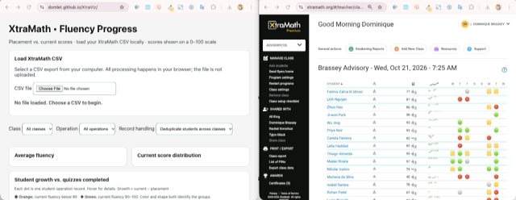

# XtraViz XtraMath Dashboard (local CSV)

This is a browser-based dashboard where [teachers can upload a local CSV](https://domlet.github.io/XtraViz/) to see insights. Student data is never uploaded or exposed to the Internet.

## How to Use

1. Log into XtraMath as OUSD teacher.
2. Export data for all classes.
3. Go to https://domlet.github.io/XtraViz
4. Upload your CSV to see insights.

See how:

## Supported CSV format

XtraMath exports with columns `Operation`, `Placement Fluency Score`, `Current Fluency Score`, `Number of Quizzes`, optionally `Class`/`Section`. Supports grouped exports with single-cell section header rows, and operation labels such as `Addition (3s)`. Quoted CSV fields and UTF-8 are supported.

## Privacy

The CSV is read using the browser's File API. There are no network requests in the app. The selected CSV and student data are **not uploaded** or saved to GitHub. The page does not retain data after refresh. Anyone with the public link can access the dashboard code, but not your locally selected file.

## Rankings

Progress leaderboard: furthest operation reached, then fluency score at that operation. Growth & practice: 70% percentile ranking of summed score improvements, 30% percentile ranking of quiz volume. Quizzes are a proxy for activity, **not verified daily practice consistency**.

## AI Attribution

@domlet made this with ChatGPT in Fall 2026.